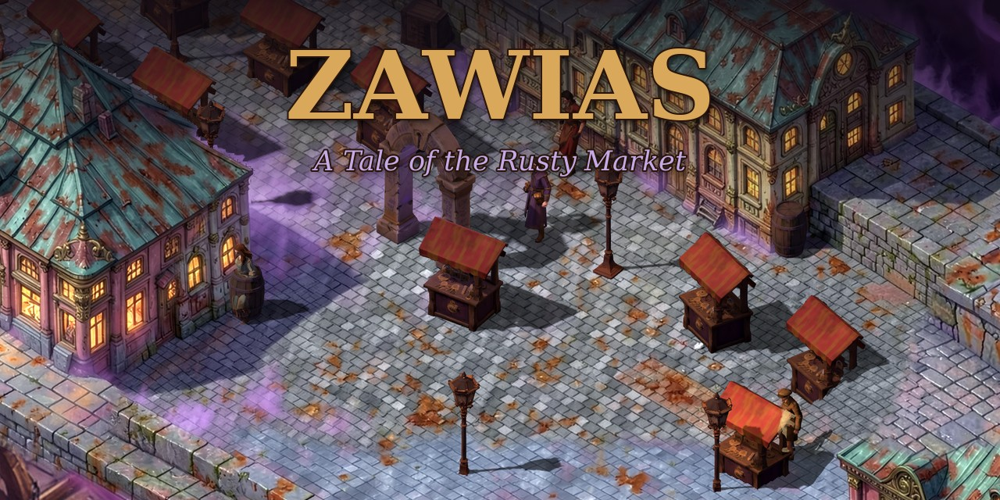
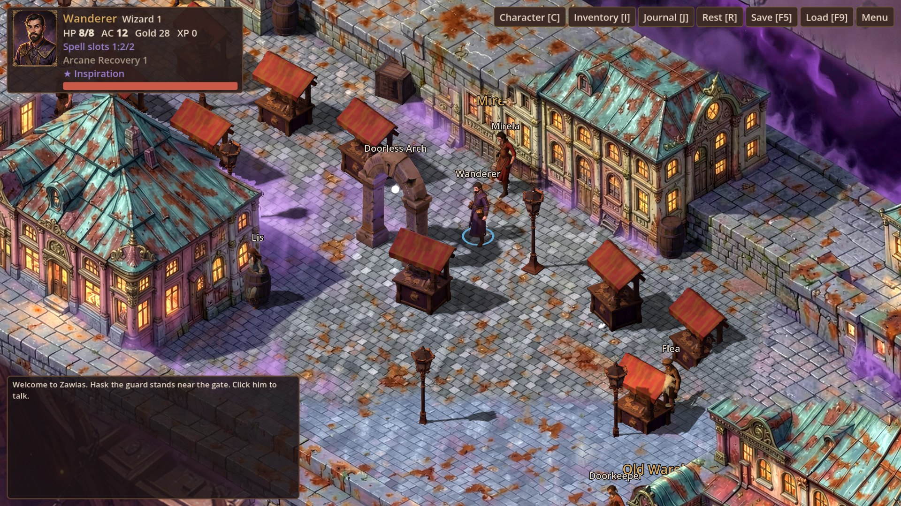
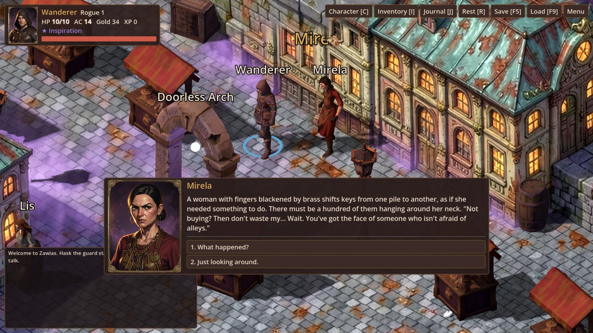
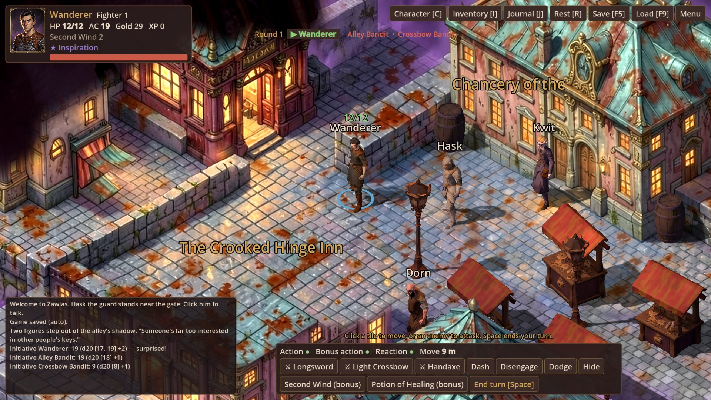
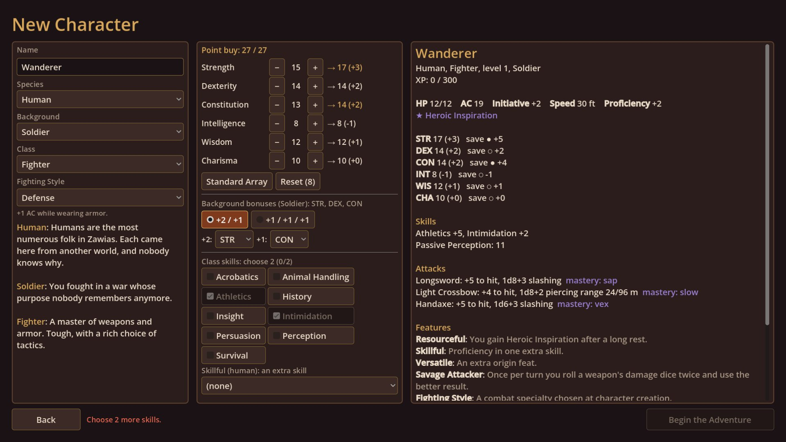

<p align="center"></p>

# Zawias: A Tale of the Rusty Market

**A 2.5D isometric RPG on the D&D 2024 rules (SRD 5.2), set in an original planar city.**
Built with Godot 4.7 (GDScript). Painted backdrops, 3D characters with real shadows, turn-based grid combat
and a quest you can finish by word, by stealth or by force.

[Polski README](README.pl.md) · [Documentation](docs/README.md) · Download: [itch.io](https://senssei.itch.io/zawias-a-tale-of-the-rusty-market)

Zawias is a ring-city hanging in the crack between the planes, where every door can become a gate if you carry
the right key, and where belief has weight. Someone has stolen the **Key Without a Door** from Mirela the keysmith.
The trail leads through the Rusty Market to the Unravelers, a faction convinced that everything falls apart, and
that this is a good thing.

| | |
|---|---|
|  |  |
|  |  |

## Features

- **SRD 5.2 rules** in pure, tested GDScript: Fighter, Rogue, Wizard and Cleric (levels 1–3 with SRD subclasses),
  4 species, 4 backgrounds with ability bonuses and origin feats (2024), point buy or standard array.
- **Turn-based grid combat**: initiative, action / bonus action / reaction / movement, opportunity attacks,
  difficult terrain, line of sight, Weapon Mastery, Sneak Attack, Shield, concentration, death saves.
- **Dialogue with skill checks** and Heroic Inspiration. One quest, three ways to solve it, two endings.
- **Level-up with choices** (HP average or roll, subclass, new spells), portraits in dialogue, music and sound effects.
- **Voiced characters and a narrator** (English, generated locally; speakers animate while talking) and a **map**: a minimap that turns with the camera, plus a full
  map (M) with fog of war, quest markers and click-to-walk. Market NPCs call out voiced barks as you pass, and Lis the
  archivist can join you as an AI-controlled companion.
- **Painted area**: the architecture is a painting (generated locally from a 3D blockout) with a depth map,
  so 3D characters and props walk behind and in front of it and cast shadows. Characters hidden behind a building
  are shown as a silhouette.
- **English and Polish** (switch in Settings), two difficulty levels (*Story* is the default for the solo slice,
  *Normal* is plain SRD), autosave before fights, save/load.

## Download and play

Builds for Windows and Linux (x86_64) are published on [itch.io](https://senssei.itch.io/zawias-a-tale-of-the-rusty-market). Unzip and run `zawias.exe` / `zawias.x86_64`.
The renderer is OpenGL 3.3 (Godot *Compatibility*), so most GPUs from the last decade work. The Windows build
is not code-signed, so SmartScreen may ask you to confirm the first launch ("More info" → "Run anyway").

**Controls**: left click to move, talk, attack and target; right click cancels. WASD/arrows pan the camera,
mouse wheel zooms. C character sheet, I inventory, K spellbook, J journal, M map, L level up, R short rest, F5/F9 save and load,
Space ends your turn, 1–9 pick dialogue choices, Esc closes windows.

## Run from source

```bash
godot --path .                 # game (Godot 4.7.x)
godot -e --path .              # editor
./run_tests.sh                 # 46 GUT tests, headless
godot --path . -- --lang=en --quickstart --class=wizard   # skip the menu
```

Export (templates 4.7.2 required, presets in `export_presets.cfg`):

```bash
godot --headless --export-release "Windows" build/windows/zawias.exe
godot --headless --export-release "Linux" build/linux/zawias.x86_64
```

Large binary assets (GLB, PNG, WAV) are stored with **Git LFS**: run `git lfs install` before cloning.

## Documentation

- [Architecture](docs/architecture.md): rules layer, combat, dialogue, world, save, autoloads.
- [The painted area](docs/painted-area.md): how a painting becomes a walkable 2.5D map with depth and shadows.
- [Asset pipeline](docs/asset-pipeline.md): local generation of characters, props, portraits, music and the painted map.
- [Writing content](docs/content.md): dialogues, quests, encounters and maps in JSON.
- [Localization](docs/localization.md): how translations work and how to add a language.
- [Development](docs/development.md): debug flags, tests, tools, release checklist.

## How the assets were made

All art, models, portraits, music and character voices were generated **locally** with open models (no cloud services),
then cleaned up, rigged and checked by scripts in [`tools/pipeline`](tools/pipeline/README.md):
FLUX.2 [klein] 4B (concepts, portraits, painted backdrop), TRELLIS.2 (3D models), Depth Anything V2 (depth),
ACE-Step 1.5 (music), OmniVoice (English character voices, checked with Whisper); sound effects are synthesized in numpy. Animations come from Quaternius' Universal
Animation Library (CC0). The world, characters and all texts are original.

## License

- Code: [MIT](LICENSE). Game assets and content (models, textures, portraits, the painting, music, voices, sound
  effects, dialogues, maps, docs): [CC-BY-4.0](LICENSES/CC-BY-4.0.txt), except the depth map below.
- Every file carries an SPDX license: a header in source files, [`REUSE.toml`](REUSE.toml) for the rest
  ([REUSE](https://reuse.software) layout, license texts in [`LICENSES/`](LICENSES)). Check: `python3 tools/dev/spdx_check.py`.
- Rules text: System Reference Document 5.2 © Wizards of the Coast LLC, [CC-BY-4.0](LICENSE-SRD.md).
- Depth of the painted backdrop (`assets/backgrounds/*_depth.png`): made with Depth Anything V2 **Large**
  (CC-BY-NC-4.0), so that file is marked CC-BY-NC-4.0 and the release as a whole is **non-commercial**.
  A commercial release would recompute depth with the Small model (Apache 2.0).
- Third-party: Godot (MIT), GUT (MIT), Quaternius UAL (CC0). Full list: *Credits and Licenses* in the main menu.
