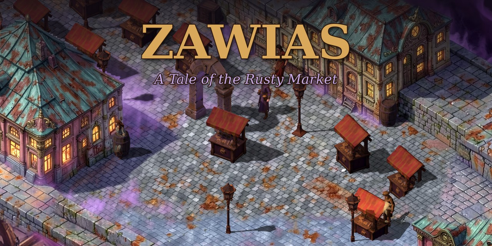
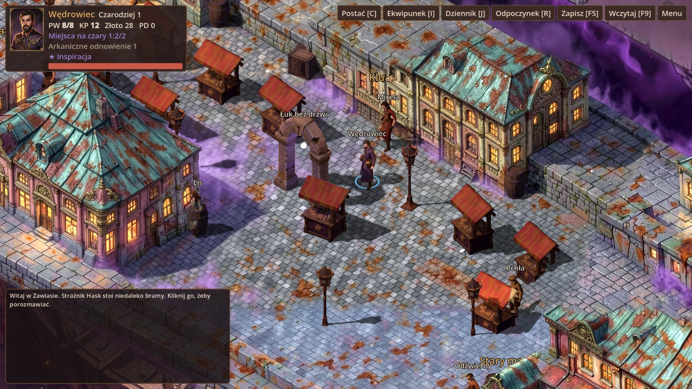
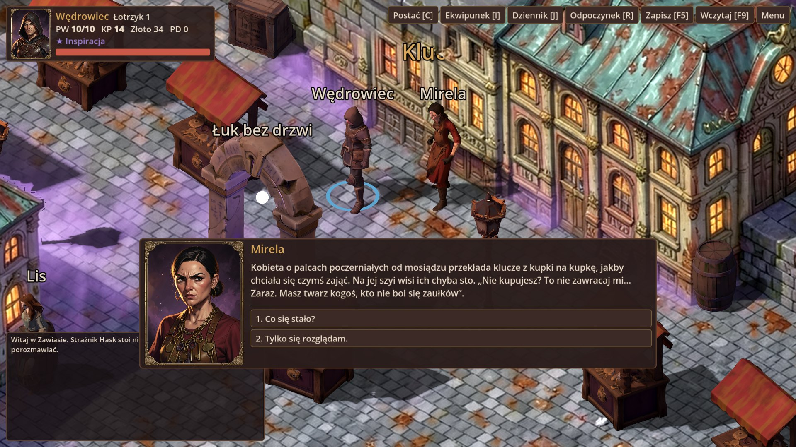
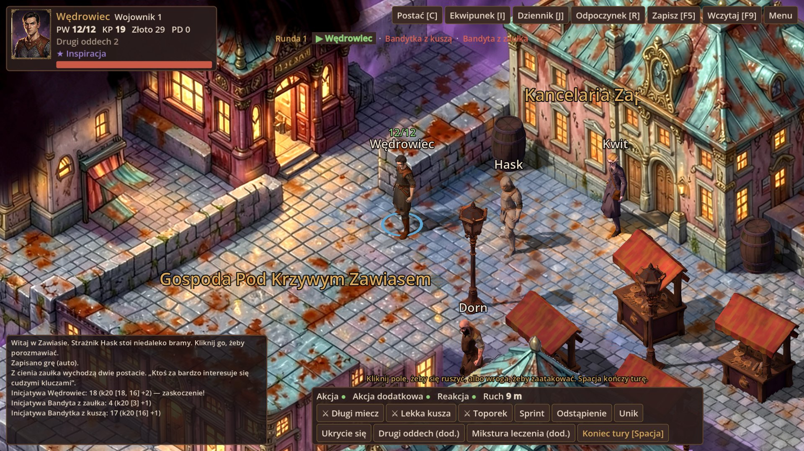
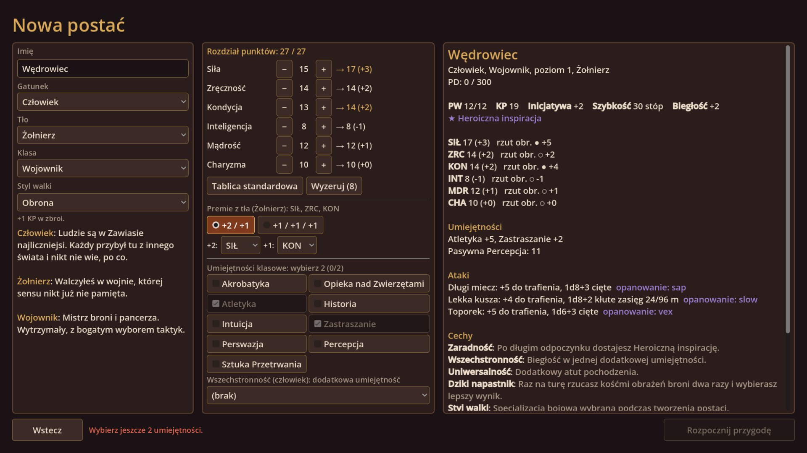

<p align="center"></p>

# Zawias: Opowieść z Rdzawego Targu

**Izometryczne RPG 2.5D na zasadach D&D 2024 (SRD 5.2), w oryginalnym, planarnym mieście.**
Godot 4.7 (GDScript). Malowane tła, postacie 3D z prawdziwymi cieniami, turowa walka na siatce
i quest, który rozwiążesz słowem, cieniem albo siłą.

[English README](README.md) · [Dokumentacja](docs/README.md) · Pobierz: [itch.io](https://senssei.itch.io/zawias-a-tale-of-the-rusty-market)

Zawias to miasto-pierścień zawieszone w szczelinie między planami. Każde drzwi mogą stać się bramą, jeśli masz
właściwy klucz, a wiara ma tu wagę. Ktoś ukradł kluczarce Mireli **Klucz bez drzwi**. Ślady prowadzą przez
Rdzawy Targ do Rozplataczy, frakcji przekonanej, że wszystko się rozpada, i że to dobrze.

| | |
|---|---|
|  |  |
|  |  |

## Co jest w grze

- **Zasady SRD 5.2** w czystym, testowanym GDScripcie: Wojownik, Łotrzyk, Czarodziej i Kapłan (poziomy 1–3,
  podklasy SRD), 4 gatunki, 4 tła z premiami do cech i atutami pochodzenia (2024), rozdział punktów albo tablica.
- **Walka turowa na siatce**: inicjatywa, akcja / akcja dodatkowa / reakcja / ruch, ataki okazyjne, trudny teren,
  linia wzroku, Weapon Mastery, Atak z zaskoczenia, Tarcza, koncentracja, rzuty przeciw śmierci.
- **Dialogi z testami umiejętności** i Heroiczną inspiracją. Jeden quest, trzy drogi, dwa zakończenia.
- **Awans z wyborami** (PW: średnia albo rzut, podklasa, nowe czary), portrety w dialogach, muzyka i efekty.
- **Głosy postaci i narrator** (angielskie, generowane lokalnie; mówiąca postać gestykuluje) i **mapa**: minimapa obracająca się z kamerą oraz pełna mapa (M)
  z mgłą nieodkrytych miejsc, celami zadania i przejściem po kliknięciu. Postacie na targu wołają do przechodzącego
  gracza (z głosem), a archiwistka Lis może dołączyć jako towarzyszka sterowana przez AI.
- **Malowany obszar**: architektura to malunek (wygenerowany lokalnie z makiety 3D) z mapą głębi, więc postacie
  i rekwizyty 3D chodzą przed nim i za nim i rzucają cienie. Postać zasłoniętą przez budynek widać jako sylwetkę.
- **Polski i angielski** (zmiana w Ustawieniach), dwa poziomy trudności (domyślna *Opowieść*, bo slice jest solowy,
  oraz *Normalny*, czyli czyste SRD), autozapis przed walką, zapis i odczyt.

## Pobranie i gra

Buildy na Windows i Linux (x86_64) są na [itch.io](https://senssei.itch.io/zawias-a-tale-of-the-rusty-market). Rozpakuj i uruchom `zawias.exe` / `zawias.x86_64`.
Renderer to OpenGL 3.3 (Godot *Compatibility*). Plik dla Windows nie jest podpisany, więc SmartScreen może poprosić
o potwierdzenie przy pierwszym uruchomieniu („Więcej informacji” → „Uruchom mimo to”).

**Sterowanie**: LPM ruch, rozmowa, atak i cel; PPM anuluje. WASD/strzałki przesuwają kamerę, kółko przybliża.
C karta postaci, I ekwipunek, K księga czarów, J dziennik, M mapa, L awans, R krótki odpoczynek, F5/F9 zapis i wczytanie,
Spacja koniec tury, 1–9 wybory w dialogu, Esc zamyka okno.

## Uruchomienie ze źródeł

```bash
godot --path .                 # gra (Godot 4.7.x)
godot -e --path .              # edytor
./run_tests.sh                 # 46 testów GUT, headless
godot --path . -- --quickstart --class=wizard   # bez menu
```

Eksport (szablony 4.7.2, presety w `export_presets.cfg`):

```bash
godot --headless --export-release "Windows" build/windows/zawias.exe
godot --headless --export-release "Linux" build/linux/zawias.x86_64
```

Duże pliki binarne (GLB, PNG, WAV) są w **Git LFS**: przed klonowaniem uruchom `git lfs install`.

## Dokumentacja

Dokumentacja w `docs/` jest po angielsku: [architektura](docs/architecture.md), [malowany obszar](docs/painted-area.md),
[pipeline assetów](docs/asset-pipeline.md), [treść w JSON](docs/content.md), [tłumaczenia](docs/localization.md),
[praca deweloperska](docs/development.md). Szczegółowy opis pipeline'u po polsku: [`tools/pipeline/README.md`](tools/pipeline/README.md).

### Poziom trudności

Spotkania są skrojone pod jedną postać tylko według budżetu SRD. Symulacja (AI po obu stronach, 40 walk na przypadek):

| klasa | Normalny: zasadzka / magazyn | Opowieść: zasadzka / magazyn |
|---|---|---|
| Wojownik | 36/40, 36/40 | 39/40, 38/40 |
| Łotrzyk | 14/40, 14/40 | 25/40, 29/40 |
| Kapłan | 14/40, 15/40 | 30/40, 28/40 |
| Czarodziej | 13/40, 1/40 | 18/40, 15/40 |

Taktyka testowa jest prosta, więc człowiek wypada lepiej. `tests/unit/test_slice.gd` przechodzi 3 drogi questu każdą klasą.

## Jak powstały assety

Grafika, modele, portrety, muzyka i głosy postaci zostały wygenerowane **lokalnie** otwartymi modelami (bez usług w chmurze),
a potem oczyszczone, zrigowane i sprawdzone skryptami z [`tools/pipeline`](tools/pipeline/README.md):
FLUX.2 [klein] 4B, TRELLIS.2, Depth Anything V2, ACE-Step 1.5, OmniVoice (angielskie głosy postaci); efekty to synteza w numpy. Animacje: Quaternius,
Universal Animation Library (CC0). Świat, postacie i teksty są oryginalne.

## Licencje

- Kod: [MIT](LICENSE). Assety i treść gry (modele, tekstury, portrety, malunek, muzyka, głosy, efekty, dialogi,
  mapy, dokumentacja): [CC-BY-4.0](LICENSES/CC-BY-4.0.txt), z wyjątkiem mapy głębi niżej.
- Każdy plik ma licencję SPDX: nagłówek w kodzie, [`REUSE.toml`](REUSE.toml) dla reszty (układ
  [REUSE](https://reuse.software), teksty licencji w [`LICENSES/`](LICENSES)). Kontrola: `python3 tools/dev/spdx_check.py`.
- Zasady: System Reference Document 5.2 © Wizards of the Coast LLC, [CC-BY-4.0](LICENSE-SRD.md).
- Głębia malunku (`assets/backgrounds/*_depth.png`): powstała z Depth Anything V2 **Large** (CC-BY-NC-4.0), więc ten
  plik ma licencję CC-BY-NC-4.0, a całe wydanie jest **niekomercyjne**.
  Wydanie komercyjne wymaga przeliczenia głębi modelem Small (Apache 2.0).
- Zależności: Godot (MIT), GUT (MIT), Quaternius UAL (CC0). Pełna lista: „Autorzy i licencje” w menu głównym.
