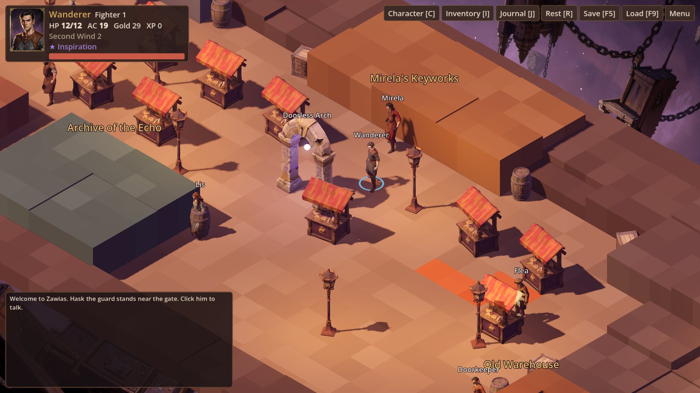

# The painted area

The look of classic isometric RPGs comes from painted backgrounds. Zawias gets it without hand-painting: the map
is built as a simple 3D blockout, an image model repaints it, a depth model reconstructs its height, and the game
places real 3D characters and props inside the painting.


*The same view with `--nopaint` (blockout) and in the shipped game ([market](media/en_market.jpg)).*

## 1. One fixed projector

`World.paint_shots()` renders the whole map from a single orthographic camera, the *projector*
(yaw 45°, pitch −35.264°, distance 40 m, 2560×1440). Its parameters are stored in
`assets/backgrounds/<map>_paint.json` and the game camera uses exactly the same angle, so the painting can be
projected back onto the world without distortion. Camera rotation is therefore locked in painted mode.

The blockout used for painting gets simple readable materials (cobbles, walls with windows, copper roofs) and
per-legend overrides in the map JSON: `"paint_height": 1.6`, `"paint_kind": "wall"`. Tall buildings at this angle
hide courtyards, so a courtyard enclosed by a building is painted as a low wall instead.

## 2. Painting in tiles

`tools/pipeline/paint_map.py` repaints the blockout with FLUX.2 [klein] in a 3×3 grid of tiles at game scale
(painting the whole map at once drifts the layout), removes props in an edit pass (they stay 3D in the game),
scores every tile for "void on the platform" and repaints bad tiles, then stitches them with minimum-error seams.
Areas outside the platform get the planar void texture.

## 3. Depth

Depth Anything V2 runs per tile (on the whole map it flattens houses). The floor is taken from the blockout depth
(RANSAC fit, exact), building heights from the model, scaled per tile. The result is encoded as 16-bit depth in
the R/G channels of `<map>_depth.png` (B marks the scene), imported **lossless, without mipmaps or VRAM
compression** (`tools/dev/check_depth_import.gd` verifies the imported resource equals the PNG).

## 4. In the game

`shaders/paint_depth.gdshader` draws a 640×360 grid mesh in front of the camera: each vertex is pushed back to the
world point reconstructed from the depth map (`P = origin + x·right + y·up − t·forward`), and each pixel writes
its own `DEPTH`. Painted buildings therefore occlude 3D characters correctly and receive and cast 3D shadows.

- **Silhouettes**: actors carry an overlay material (`shaders/xray.gdshader`, `depth_test_inverted`) that draws
  only where they are hidden: blue for the player, gold for NPCs, red for enemies, muted for chests and doors.
  The mesh is pushed 1 m toward the camera so a character never shows through its own cloak.
- **Camera clamp**: the camera never leaves the painting's rectangle.
- **Renderer**: tested on *Compatibility* (OpenGL 3.3), which the exports use. The Forward+ branch of the shaders is untested.

## 5. Does the painting agree with collisions?

The painter can invent buildings where the map is walkable. The check step stands a virtual character on every
walkable cell (samples at 0.4 / 0.9 / 1.4 m, five offsets) and flags cells where the painted depth hides it but
the blockout does not. Cells clearly built over in the painting go to `blocked` in `_paint.json` and the game blocks
them, except key cells (NPCs, objects, doors, triggers, spawns) and cells whose blocking would cut the map apart
(8-way BFS). It also warns about NPCs standing behind buildings. Report: `work/paint_<map>/cells_check.png`.

On the Rusty Market the check ends with 19 cells where only the feet are slightly clipped and no cell to block.

## Re-painting a map

```bash
tools/pipeline/pipeline.sh paint <map_id>                        # full run, about 6 minutes on an RTX 5070
tools/pipeline/pipeline.sh paint <map_id> --fix --from paint     # repaint only tiles that fail the void check
tools/pipeline/pipeline.sh paint <map_id> --from check           # re-run only the collision check
```

Any change to buildings or props in the map JSON requires painting again.
